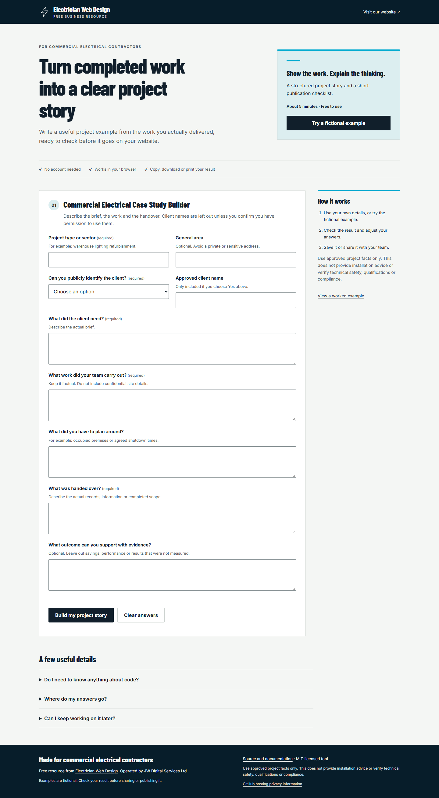

# Commercial Electrical Case Study Builder

Write a useful project example from the work you actually delivered, ready to check before it goes on your website.

**For commercial electrical contractors. No coding knowledge needed.**

[Open the free tool](https://electrician-web-design.github.io/electrical-project-story-builder/) · [See a fictional worked example](https://electrician-web-design.github.io/electrical-project-story-builder/examples/customer-output.html)



## How to use it

1. Open the tool in your browser. No installation or account is needed.
2. Use your own business details in the labelled fields, or choose **Try a fictional example**.
3. Choose **Build my project story** and review the result.
4. Adjust your answers, then copy the result, download a text file or choose **Print / Save PDF**.

A structured project story and a short publication checklist.

## What to expect

Describe the brief, the work and the handover. Client names are left out unless you confirm you have permission to use them.

Use approved project facts only. This does not provide installation advice or verify technical safety, qualifications or compliance.

Your answers are processed in the browser tab. They are not uploaded, emailed or saved by the tool. Refreshing or closing the tab clears them. Save your result before leaving. GitHub provides hosting and handles normal request logs. Example details are fictional, not customer results.

## Design and maintenance

The interface uses the colours, typography and visual treatment of [Electrician Web Design](https://electricianwebdesign.uk/). The tool is maintained by Electrician Web Design, operated by JW Digital Services Ltd. The commercial website is a separate project.

## For developers

The customer tool uses native HTML controls and small browser modules, with no runtime framework. Its planning or calculation rules are in `src/customer.js`; presentation helpers are in `src/customer-ui.js`.

```sh
npm ci --ignore-scripts
npm test
npm run build
npm run serve
```

Open the local address printed by the server. `npm run build:pages` prepares the static GitHub Pages artifact. Tests cover the customer rules and output escaping.

The original v0.1 developer helpers remain in `src/index.js` for compatibility, with their original examples. They are not needed to use the customer tool. The existing repository name and Pages URL are retained so earlier links keep working.

## Licence and feedback

MIT for tool code. Bundled typefaces retain their original licence notices in `demo/assets/font-licences`. [Ideas and feedback](https://github.com/Electrician-Web-Design/electrical-project-story-builder/discussions/1).
